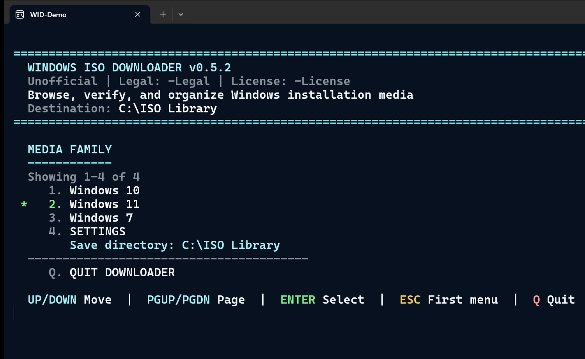
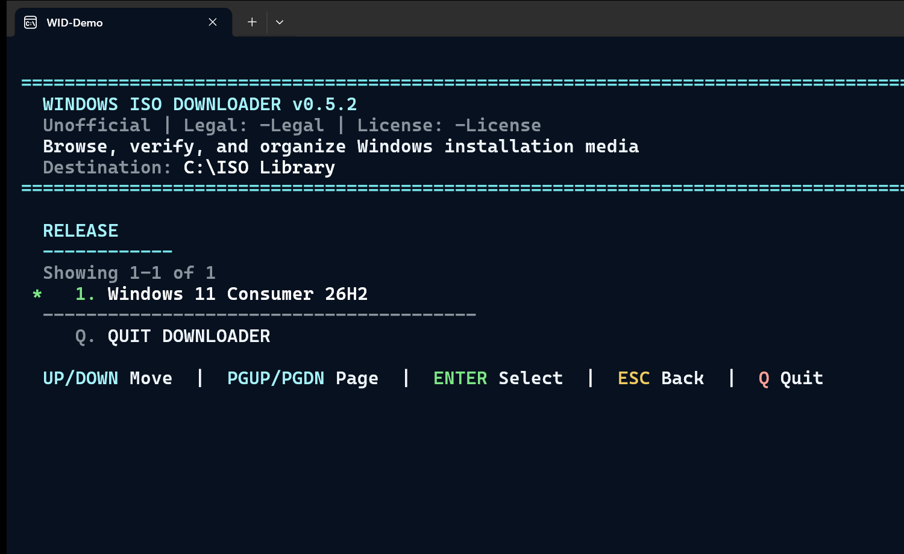

<p align="center">
  
</p>

<h1 align="center">Windows ISO Downloader</h1>

<p align="center"><strong>💿 Browse. Verify. Download with context.</strong></p>

<p align="center">
  <a href="https://github.com/gilp456/windows-iso-downloader-dist/releases/latest"></a>
  <a href="LICENSE"></a>
  
</p>

Windows ISO Downloader is a preview PowerShell utility for browsing, verifying, and organizing Windows installation media using public catalog documentation maintained by the [Massgravel project](https://github.com/massgravel/massgrave.dev).

> **Unofficial utility.** This project is independent and is not affiliated with, sponsored by, approved by, or endorsed by Microsoft, Massgravel, or any download provider. The repository and release packages contain downloader code and metadata only; they do not contain Windows or Office installation media. Downloading installation media does not grant a license to install or use Microsoft software.

## What it does

- 🎯 Guides you through a keyboard-friendly catalog by product family, release, language, architecture, and image.
- 🔎 Discloses the catalog source, payload provider, download host, expected filename, and verification level before transfer.
- ⚡ Tests eligible sources, measures bounded probe speeds, and selects a working source without hiding where the file comes from.
- 🧾 Verifies byte length and SHA-256 where authoritative metadata is available, then writes a local evidence manifest beside the ISO.
- 📁 Remembers your chosen library directory and keeps downloaded media outside the application install folder.

## Menu preview

These are real v0.5.2 captures produced with a sanitized offline catalog. No installation media was downloaded for the screenshots.

| Media family menu | Release selection |
| --- | --- |
|  |  |

## Install or update

Open Windows PowerShell or PowerShell and run:

```powershell
irm https://gilp456.github.io/windows-iso-downloader-dist/bootstrap.ps1 | iex
```

The bootstrap installs the current release for your Windows account, adds `get-windows-iso` to your user PATH, and launches the downloader. Administrator access is not required. The command wrapper uses a process-only execution-policy bypass for the verified installed files; it does not change Windows execution-policy settings.

To install without launching the menu:

```powershell
& ([scriptblock]::Create((irm https://gilp456.github.io/windows-iso-downloader-dist/bootstrap.ps1))) -InstallOnly
```

To select a download folder for the current launch:

```powershell
& ([scriptblock]::Create((irm https://gilp456.github.io/windows-iso-downloader-dist/bootstrap.ps1))) -SaveDirectory 'D:\ISOs'
```

After installation, launch it with:

```powershell
get-windows-iso
```

## Verification and storage

The public bootstrap pins the release ZIP URL, byte length, and SHA-256. It verifies the archive and every packaged file before atomically activating a version under `%LOCALAPPDATA%\WindowsIsoDownloader`.

Saved settings remain outside version folders. Downloaded ISO files remain in the directory selected by the user and are never removed by the installer or default uninstaller.

The downloader records the catalog source, catalog retrieval time, payload source, byte length, and SHA-256 in its local evidence manifest. A matching hash establishes catalog identity and integrity; it does not establish provenance, authorization, ownership, or a software license.

## License, attribution, and legal information

The standalone downloader runtime is licensed under [GPL-3.0-only](LICENSE). See the [legal notice](LEGAL.md) for the distribution and Microsoft-software licensing boundary, [notices and attribution](NOTICE.md) for upstream catalog and resolver sources, and the [content-removal process](CONTENT_REMOVAL.md) for link or metadata concerns.

Installed users can read the same core notices without entering the interactive menu:

```powershell
get-windows-iso -Legal
get-windows-iso -License
```

This tool contains no activation, product-key generation, license bypass, or DRM-circumvention functionality. Microsoft, Windows, and Office are trademarks of the Microsoft group of companies. Other trademarks belong to their respective owners.

## Relationship to Massgravel and Microsoft

The catalog documentation comes from the `massgravel/massgrave.dev` repository, operated by the Massgravel organization behind [Microsoft Activation Scripts](https://github.com/massgravel/Microsoft-Activation-Scripts). This downloader does not bundle, invoke, or provide Microsoft Activation Scripts, and it contains no activation functionality. Catalog transformations and this utility are independent work; Massgravel does not endorse them.

Windows and Office media remain subject to the applicable [Microsoft Software License Terms](https://www.microsoft.com/en-us/useterms) and other Microsoft terms. Microsoft provides its published [trademark and brand guidance](https://www.microsoft.com/en-us/legal/intellectualproperty/trademarks). The project uses product names only to describe compatibility and distributes no Microsoft logos or product artwork.

## Uninstall

```powershell
uninstall-windows-iso-downloader
```

This preserves saved settings and downloaded media. To remove saved settings too:

```powershell
uninstall-windows-iso-downloader -PurgeSettings
```

## Status

Version `0.5.2` is a preview release. The public repository contains only distribution files; development occurs in a separate private repository.
